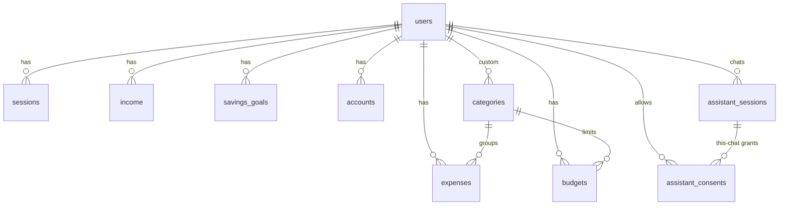

# Tables

What each user holds. All of these tables are in `backend/app/schema.sql`; the open questions at the bottom may still change them.

## Conventions

- Every table belongs to a user through `user_id → users.id`, with `ON DELETE CASCADE` so deleting an account deletes its data.
- Money is stored as integer cents (`amount_cents`, `1999` = $19.99) to avoid floating-point rounding.
- Dates are ISO text (`2026-10-10`, months as `2026-10`); SQLite has no date type.

## Existing tables

- **users** — `id`, `email`, `password_hash`, `display_name`, `created_at`, `nessie_customer_id` (the linked Capital One Nessie sandbox customer, if any)
- **sessions** — `token`, `user_id`, `expires_at` (login tokens)

## Proposed tables

### categories

| Column | Type | Notes |
|---|---|---|
| id | INTEGER PK | |
| user_id | INTEGER, nullable | `NULL` = built-in default everyone sees; set = a user's custom category |
| name | TEXT | e.g. "Groceries" |
| icon | TEXT, nullable | for the frontend (emoji or icon name) |
| color | TEXT, nullable | hex color for charts |

### income

| Column | Type | Notes |
|---|---|---|
| id | INTEGER PK | |
| user_id | INTEGER | |
| source | TEXT | e.g. "Paycheck", "Scholarship" |
| amount_cents | INTEGER | |
| frequency | TEXT | `once`, `weekly`, `biweekly`, `monthly` |
| received_on | TEXT | date |
| nessie_id | TEXT, nullable, unique | Nessie deposit id; stops the same deposit being imported twice |

### expenses

| Column | Type | Notes |
|---|---|---|
| id | INTEGER PK | |
| user_id | INTEGER | |
| category_id | INTEGER | → categories |
| amount_cents | INTEGER | |
| description | TEXT | e.g. merchant name |
| spent_on | TEXT | date |
| source | TEXT | `manual` or `nessie` |
| nessie_id | TEXT, nullable, unique | Nessie purchase id; stops the same purchase being imported twice |

### budgets

| Column | Type | Notes |
|---|---|---|
| id | INTEGER PK | |
| user_id | INTEGER | |
| category_id | INTEGER | → categories |
| month | TEXT | `YYYY-MM` |
| limit_cents | INTEGER | |

One budget per user, category and month (unique on `user_id, category_id, month`).

### savings_goals

| Column | Type | Notes |
|---|---|---|
| id | INTEGER PK | |
| user_id | INTEGER | |
| name | TEXT | e.g. "Spring break" |
| target_cents | INTEGER | |
| saved_cents | INTEGER | progress so far |
| target_date | TEXT, nullable | date |

### accounts

Bank accounts copied from the Capital One Nessie sandbox by the sync. Account numbers are never stored.

| Column | Type | Notes |
|---|---|---|
| id | INTEGER PK | |
| user_id | INTEGER | |
| nessie_id | TEXT, unique | Nessie account id |
| type | TEXT | e.g. "Checking", "Savings" |
| nickname | TEXT, nullable | e.g. "Everyday" |
| balance_cents | INTEGER | as of the last sync |
| synced_at | TEXT | ISO timestamp of the last sync |

## Gill Gates tables

Used only by the assistant. See `GILL_GATES_DESIGN.md`.

### assistant_sessions

One row per chat. Deleted 24h after the last activity, on "clear chat", and cleared when the student turns off access to data it contains.

| Column | Type | Notes |
|---|---|---|
| id | TEXT PK | random token, e.g. `as_4fQ2…` |
| user_id | INTEGER, nullable | `NULL` = guest chat |
| state | TEXT | `ready`, `awaiting_input`, `awaiting_consent` |
| transcript | TEXT (JSON) | Gemini conversation, each turn tagged with the consent scopes its data came from |
| pending | TEXT (JSON), nullable | tool calls waiting on the student (a card or a consent decision) |
| meta | TEXT (JSON) | small bookkeeping: declined scopes, app notices, message counter |
| model | TEXT | Gemini model the chat started with |
| prompt_version | TEXT | e.g. `gill-v1` |
| created_at / updated_at | TEXT | ISO timestamps |

### assistant_consents

What the student has allowed Gill to read. No row = not allowed. "Allow once" is never stored (only audited).

| Column | Type | Notes |
|---|---|---|
| id | INTEGER PK | |
| user_id | INTEGER | |
| scope | TEXT | `transactions.summary.read`, `transactions.history.read`, `balances.read`, `budget_goals.read` |
| duration | TEXT | `chat` (one chat only) or `always` (until turned off) |
| session_id | TEXT, nullable | set for `chat`; deleting the chat deletes the grant |
| max_lookback_days | INTEGER | how far back transaction reads may reach (0 for balances/budgets) |
| granted_at | TEXT | |
| revoked_at | TEXT, nullable | set when the student turns access off |

### assistant_audit_log

What happened, never the data itself (no amounts, balances or descriptions).

| Column | Type | Notes |
|---|---|---|
| id | INTEGER PK | |
| user_id | INTEGER, nullable | |
| session_id | TEXT, nullable | |
| event | TEXT | `session_created`, `tool_call`, `consent_granted`, `consent_denied`, `consent_revoked`, `card_answered`, `user_saved` |
| tool | TEXT, nullable | tool name (or save target) |
| scope | TEXT, nullable | |
| outcome | TEXT, nullable | e.g. `ok`, `consent_required`, `not_available`, `invalid_arguments`, `once`, `always` |
| created_at | TEXT | |

## Relationships

## Default categories

- Auto
- Groceries
- Rent/Home
- Education
- Insurance
- Subscriptions
- Bills
- Shopping
- Travel
- Eating out (separate from groceries)
- Debt payments (loans, credit card)

**Suggested additions** (keep or cut):

- Health/Medical
- Entertainment
- Utilities
- Personal care
- Gifts/Donations
- Other (catch-all, especially for imported purchases that don't match anything)

## Open questions

1. **Guests:** Accounts are optional. Does a guest's data persist anywhere (browser storage only?), or is guest mode demo-only?
2. ~~**Nessie import:** Do we copy Nessie purchases into `expenses`, or read them live from Nessie each time?~~ **Decided: copy.** `POST /nessie/sync` copies accounts, purchases and deposits; `users.nessie_customer_id` holds the link.
3. ~~**Category mapping:** How do Nessie merchant categories (`food`, `transport`, …) map onto ours?~~ **First version:** `CATEGORY_MAP` in `backend/app/services/nessie_sync.py` (unknown → uncategorized). Change it there.
4. **Bills vs Subscriptions vs Utilities:** Where's the line? Should any of them merge?
5. **Budgets:** Set fresh each month, or one standing limit per category that repeats until changed?
6. **Recurring expenses** (rent, subscriptions): Give `expenses` a `frequency` like `income` has, or enter them each month?
7. **Savings goals:** Can a user have several, or just one? Should a goal link to a Nessie savings account?
8. **Default categories:** Can users rename or hide the built-in ones?
9. **Overall budget:** Is there a total monthly budget too, or only per-category limits?
